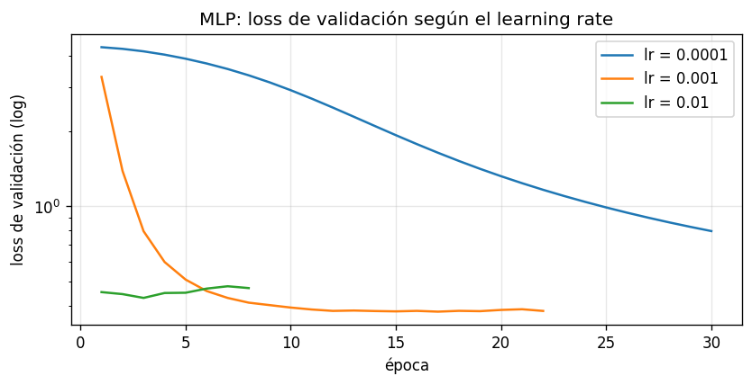
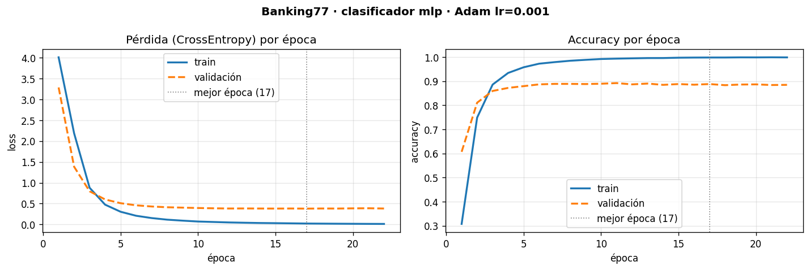

# Clasificación de consultas bancarias — Proyecto Final DS III

[](https://colab.research.google.com/github/BaltaGalelli/ds3-proyecto-final/blob/main/notebooks/01_pipeline_base.ipynb)

**Data Science III — NLP & Deep Learning (Coderhouse)** · **Autor:** Baltasar Santiago Galelli

## El problema

Un banco recibe miles de consultas de clientes por día ("mi tarjeta no llegó", "me rechazaron una transferencia", "¿por qué me cobraron esta comisión?") y alguien tiene que leerlas y derivarlas al área correcta. Este proyecto construye un modelo que **clasifica automáticamente cada consulta según su motivo**, para derivarla al instante y medir qué problemas son más frecuentes.

**Dataset:** [Banking77](data/README.md): 13.083 consultas reales de clientes de un banco (en inglés), con 77 motivos. Licencia CC BY 4.0.

## Pre-entrega 1: pipeline de entrenamiento, validación y clasificador base

Esta entrega construye la **infraestructura** del proyecto: un pipeline reproducible en PyTorch con detección automática del dispositivo, ciclo de entrenamiento explícito, validación por época, métricas y early stopping. El modelo es simple a propósito: texto en **TF-IDF** y un **MLP**. Es la vara contra la que se van a comparar las *embeddings* y los Transformers de las próximas entregas.

### Configuración del experimento

| | |
|---|---|
| **Versión de PyTorch** | `2.14.1` (CPU). El código detecta solo `cuda` / `mps` / `cpu` |
| **Partición** | test oficial intacto (3.080); validación = 15% del train oficial, estratificada (8.502 train / 1.501 validación) |
| **Representación del texto** | TF-IDF de unigramas y bigramas, `min_df=2`, ajustado solo con train → 9.232 términos |
| **Modelo** | MLP `9.232 → 256 → 77` con ReLU y dropout 0.3 (2,4 M de parámetros) |
| **Baseline** | clasificador lineal `9.232 → 77` (regresión logística multiclase) |
| **Pérdida / optimizador** | `CrossEntropyLoss` / `Adam` |
| **Learning rate** | **`0.001`** |
| **Batch / épocas** | 64 / hasta 30, con early stopping (paciencia 5) sobre la loss de validación |
| **Métricas por época** | loss, accuracy y F1 macro (train y validación) |
| **Semilla** | 42 (Python, NumPy, PyTorch, dropout y orden de los batches) |

### Por qué `learning_rate = 0.001`

Se probaron tres órdenes de magnitud con el MLP, comparando la **loss de validación**:

| learning rate | mejor época | mejor loss de validación | accuracy de validación | Diagnóstico |
|---|---|---|---|---|
| 0.0001 | 30 (de 30) | 0.796 | 86.7% | demasiado lento: seguía bajando al terminar |
| **0.001** | 17 | **0.380** | **88.8%** | **el mejor** |
| 0.01 | 3 | 0.431 | 87.6% | toca su mínimo enseguida y después empeora |



### Resultados



**Interpretación de la curva de pérdida:**

- **La pérdida bajó.** En train, durante todas las épocas; en validación, hasta la época 17 (de 3.29 a 0.38), con la caída fuerte en las primeras 5.
- **Desde la época ~12 la validación se estanca** mientras el train sigue bajando hacia 0: el modelo empieza a memorizar el train (sobreajuste). El early stopping corta en la época 22 y se queda con los pesos de la 17.
- **La brecha train-validación es grande** (accuracy 99.8% vs 88.8%): con 9.232 términos y unas 110 consultas por motivo, el MLP tiene capacidad de sobra para memorizar. Es la principal limitación de TF-IDF, y lo que las *embeddings* deberían mejorar.

| Modelo | Parámetros | Loss val. | Accuracy val. | Accuracy test | F1 macro test |
|---|---|---|---|---|---|
| Lineal (baseline, lr 0.01, hasta 60 épocas) | 710.941 | 0.461 | 87.2% | 87.4% | 0.875 |
| **MLP** | 2.383.437 | **0.380** | **88.8%** | **89.8%** | **0.899** |

Los errores del modelo se concentran en motivos que a un humano también le costaría separar: *verificar mi identidad* vs *por qué tengo que verificarla*, *recarga fallida* vs *recarga revertida*, *transferencia pendiente* vs *saldo no actualizado*. El análisis completo está en la sección 8 del notebook.

## Estructura del repositorio

```
ds3-proyecto-final/
├── data/                     # README con fuente, licencia y hashes (los CSV se descargan solos)
├── notebooks/
│   └── 01_pipeline_base.ipynb   # pipeline completo ejecutado: exploración, entrenamiento, resultados
├── src/pipeline/             # código reutilizable
│   ├── config.py             # hiperparámetros y rutas en un solo lugar (dataclass Config)
│   ├── entorno.py            # semillas y detección de dispositivo
│   ├── datos.py              # descarga verificada, partición, TF-IDF y DataLoaders
│   ├── modelos.py            # ClasificadorLineal y ClasificadorMLP (nn.Module)
│   ├── entrenamiento.py      # training loop, validación, métricas y early stopping
│   └── reportes.py           # curvas y guardado de resultados
├── scripts/entrenar.py       # el pipeline completo por línea de comandos
├── tests/                    # 11 tests de las piezas del pipeline (pytest)
├── reports/                  # métricas (JSON), historial por época (CSV) y figuras
├── models/                   # pesos entrenados (.pt, no se versionan)
├── requirements.txt
└── README.md
```

## Cómo ejecutarlo

**Google Colab:** botón *Open in Colab* → *Entorno de ejecución → Ejecutar todas* (unos 5 minutos en CPU). La primera celda clona el repositorio; no hace falta instalar nada. Con GPU (*Cambiar tipo de entorno → GPU*) el código la usa solo.

**Local:**

```bash
git clone https://github.com/BaltaGalelli/ds3-proyecto-final.git
cd ds3-proyecto-final
python -m venv .venv && source .venv/bin/activate     # Windows: .venv\Scripts\activate
pip install -r requirements.txt

python scripts/entrenar.py                                          # MLP (configuración por defecto)
python scripts/entrenar.py --arquitectura lineal --lr 0.01 --epocas 60   # baseline
pytest                                                              # tests
```

Cada corrida imprime las métricas por época y guarda en `reports/` el historial (`historial_<modelo>.csv`), las métricas finales (`metricas_<modelo>.json`) y las curvas (`figures/curvas_<modelo>.png`), y en `models/` los pesos de la mejor época. Con la misma semilla, los resultados son idénticos en cada corrida.

## Decisiones de diseño

- **Ciclo de entrenamiento explícito** (`src/pipeline/entrenamiento.py`): `zero_grad()` → forward → loss → `backward()` → `step()` en cada batch. Los gradientes los calcula `torch.autograd` a través de `loss.backward()`.
- **Consistencia de dispositivos:** el modelo y cada batch se mueven con `.to(dispositivo)`; las métricas se calculan en CPU.
- **Validación sin gradientes:** `model.eval()` (apaga el dropout) + `@torch.no_grad()`.
- **Sin fuga de información:** el TF-IDF se ajusta solo con train; el learning rate y la mejor época se eligen con validación; el test oficial se usa una sola vez. Un test lo verifica: las palabras que aparecen solo en el test no están en el vocabulario.
- **Matriz dispersa:** el TF-IDF se guarda disperso (en promedio, ~18 términos distintos de cero por consulta sobre 9.232) y cada batch se convierte a denso recién al entrar al modelo.
- **F1 macro además de accuracy:** el train está desbalanceado (35 a 187 consultas por motivo); el F1 macro pesa igual a todos los motivos.
- **Datos verificados:** descarga fijada a un commit y verificada con SHA-256.

## Próximos pasos

1. Reemplazar TF-IDF por *embeddings* aprendidas y comparar contra este baseline.
2. Ajustar un Transformer preentrenado.
3. Traducir las consultas al español y evaluar el modelo en nuestro idioma.
4. Generar una respuesta sugerida para cada consulta.
